# deckgen

Topic in, researched and sourced PowerPoint out. The LLMs emit structured content; the renderer owns geometry; every
slide is rendered with headless LibreOffice and inspected before the deck is returned.

```mermaid
flowchart LR
  R[Request: topic, audience, slides, brand] --> P[1 Planner: brief + questions]
  P --> A[2 Research agent: LangGraph loop, cached search/fetch, sanitizer]
  A -->|findings.json with citations| O[3 Outliner + human approval]
  O --> S[4 Spec generator: flat SlideDraft -> SlideSpec, rules + retries]
  S --> B[5 Renderer: Node + pptxgenjs, brand theme + named layouts]
  B --> F[6 File QA: validate_pptx, content extract, shape checks]
  F --> V[7 Render: soffice -> PDF -> PNG]
  V --> C[Visual critic: images + checklist only]
  C -->|blocking issues| X[Fixer: small diffs, no word growth, keep only if better]
  X --> B
  C -->|clean| D[deck.pptx + sources.md + run_report.md]
```



## Setup

```
python -m venv .venv && .venv/Scripts/pip install -e ".[dev]"
npm install
docker build -f Dockerfile.lo -t deckgen-lo .      # headless LibreOffice + poppler + Carlito/Caladea (or install soffice + pdftoppm)
cp .env.example .env                              # put your keys here; .env is git-ignored, never commit it
cp config/anthropic_run.env.example config/anthropic_run.env   # optional: Anthropic role mapping (git-ignored)
deckgen doctor
```

## Use

```
deckgen brand build --brand brand/default_v1
deckgen generate --topic "The golden era of WRC Group B (1980s)" --audience "motorsport enthusiasts" --slides 14 [--auto-approve]
deckgen qa --spec path/to/deck_spec.json --run my_run
deckgen eval --golden evals/golden_topics.json
```

Each run writes `runs/<run_id>/`: `brief.json`, `findings.json`, `outline.json`, `deck_spec.json`, `deck_spec.final.json`,
`qa_report.md`, `deck.pptx`, `final/images/`, `sources.md`, `run_report.md`, `trace.jsonl`. Re-running a run id skips
finished stages; `--from-stage` forces a re-run from that stage (search and fetch results stay cached in `runs/_cache`).

For QA and evals pin one model so results are comparable: `DECKGEN_MODEL=gemini-3.1-flash-lite DECKGEN_PIN_MODELS=1`.
Without pinning, quota or demand errors fall through `DECKGEN_FALLBACK_MODELS`, and the models that actually served
each run are listed in `run_report.md` and `qa_report.md`.

## Swapping brand packages

A brand is a folder under `brand/` with `theme.json` (name, two fonts, 12 theme colors, footer, motif icon),
`layouts.js` (named layouts and placeholders) and `style_guide.md` (loaded into spec prompts). Restyle by editing
`theme.json` only: shapes use scheme colors, and `apply_theme.js` writes the colors and fonts into the saved deck.
`manifest.json` is generated from `layouts.js` (`deckgen brand build`) and is the enum the spec generator validates against.
Use another brand with `--brand <folder name>`.

## Design of the QA loop

Blocking issues are overflow/cut-off, overlap, low contrast, footer collision, file/content breakage and automated
shape-check failures. Spacing and alignment claims block only when the automated check confirms them. Everything
else (empty space, style consistency) is reported in `qa_report.md` but never triggers a fix round. Fixes run one
phase per round (overflow, then overlap, then contrast), apply small diffs that may only shorten or delete, and a
round is kept only if the blocking score improves; otherwise the loop reverts to the best deck and stops.

## Known limitations

- Not yet opened in real Microsoft PowerPoint. File QA catches known-corrupt constructs, but a human check on Windows
  (repair dialog, fonts, overflow) is still the biggest unverified risk.
- Gemini free tier allows about 20 requests per day per model on some models; a full run needs well over 100 calls.
  Use a billed key or the lite models.
- The critic is a vision LLM: it misses subtle problems and sometimes invents others. Blocking is limited to categories
  it can judge, and the automated checks own geometry.
- Number grounding checks that chart, stat and year values appear in the cited findings; it cannot check what they mean.
- No images (`image_request`) and no org-template mode yet (Phase 2). The corpus module is stubbed off (`corpus.enabled=false`).
- Slide splitting and layout switching as automatic fixes are not implemented; fixes are trim/delete only.


## Providers, roles, gates (round 2)

- **Providers**: one file per provider in `src/deckgen/providers/` (gemini, groq, anthropic, fake). Roles map to `provider:model`:
  `DECKGEN_ROLE_EXTRACTOR|WRITER|CHECKER|CRITIC="groq:openai/gpt-oss-120b"` (comma-separate fallbacks). The checker should be a different model family than the writer.
  LLM responses are cached by prompt hash in `runs/_cache/llm` (`--no-cache`); rate limits are honoured by waiting; per-role call/token budgets are reported.
- **Gates**: `deckgen checks` lists every check with its category (correctness | model_compensation) and severity under the `strict` and `demoted` profiles
  (`DECKGEN_GATES`, default demoted). Hard gates drive repair; warnings go to `review_before_use.md` and never drop a slide. See `docs/CHECKS.md`.
- **Research**: full pages, relevant passages only, rounds until the raw pool reaches `DECKGEN_TARGET_FINDINGS`; source tiers (`config/source_tiers.json`, per-topic
  overrides in `config/tier_overrides/`), independent origins, conflict resolution by weight. **Writing**: whole weighted pool, write once, fix with small diffs.
- **Experiments**: `deckgen experiment --base-run <id> --runs 3`; **evals**: `deckgen eval --runs 3` (7 golden topics, go/no-go in `runs/eval2/summary.md`).
- When the Anthropic key arrives: `docs/RETEST_ANTHROPIC.md`.
